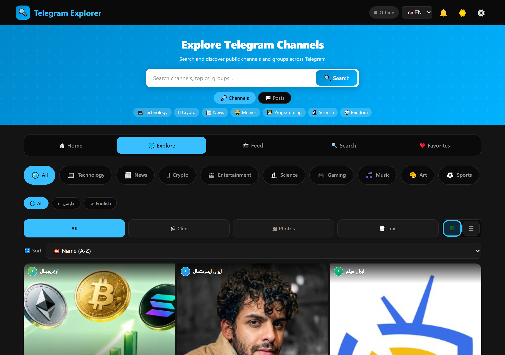
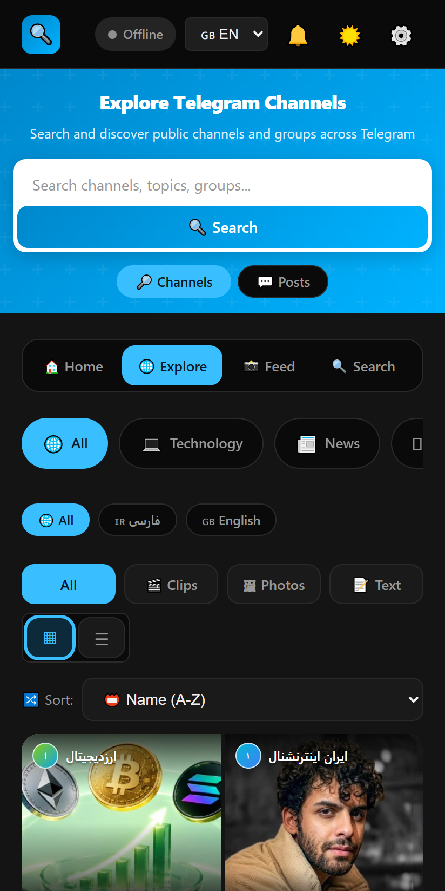
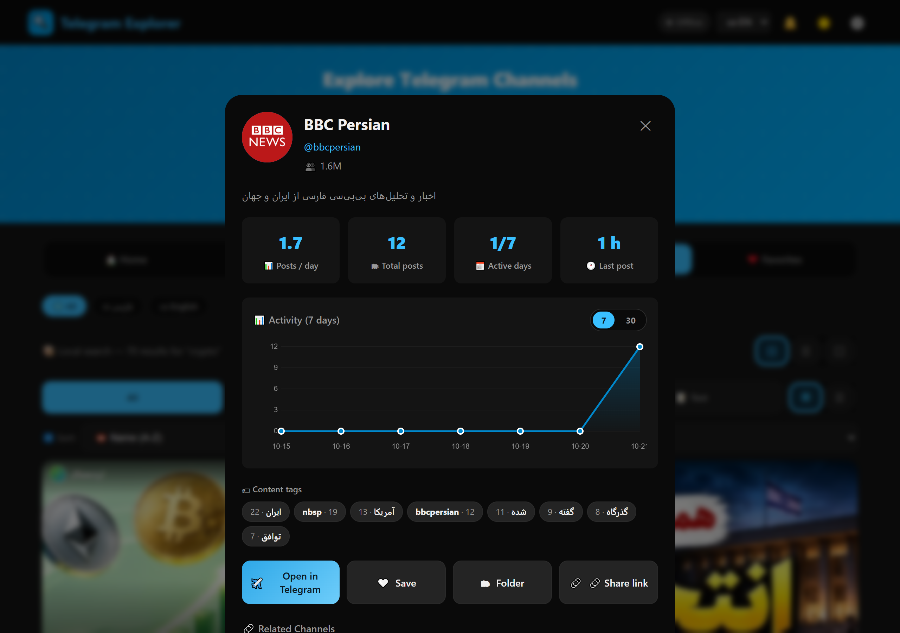

# 🔍 Telegram Explorer

Search and discover public Telegram channels and groups — like Instagram Explore, but for Telegram.

[](https://github.com/mohsen-niksirat/tgexplorer/actions/workflows/test.yml)
[](https://github.com/mohsen-niksirat/tgexplorer/actions/workflows/crawl.yml)
[](https://github.com/mohsen-niksirat/tgexplorer/actions/workflows/avatars.yml)
[](LICENSE)
[](manifest.json)
[](#-supported-languages)
[](#-privacy)



## 💡 Why Telegram Explorer?

Telegram's own search finds **messages**, not **channels** — you need to know
the name you are looking for. Telegram Explorer does the opposite: it keeps a
**verified database of public channels** (every one checked live against
`t.me`), lets you browse them like Instagram Explore, and shows you what each
one actually posts — so you can find a channel by *topic*, *language* or
*what it publishes*, not by name.

| | Telegram search | Telegram Explorer |
|---|---|---|
| Find a channel by name | ✅ | ✅ |
| Find a channel by **topic** (tech, news, crypto…) | ❌ | ✅ |
| Multi-select filters, shareable as a link | ❌ | ✅ |
| Search **inside** the posts | ❌ | ✅ |
| See the activity chart and content tags | ❌ | ✅ |
| Know the channel is still alive | ❌ | ✅ (re-verified daily) |
| Works without an account, without a proxy | partially | ✅ |

<p align="center">
  
  
</p>

## ✨ Features

- 🔍 **Smart Search** — fuzzy matching (typo-tolerant) + Persian/English language filter
- 💬 **Search inside the posts** — find the channels that talked about a topic, not just the ones named after it
- 🎛️ **Advanced filters** — multi-select category, language and content type, mirrored into the URL so a filtered view can be shared
- 🏠 **Explore** — browse **verified** public channels by category (every one checked live against t.me)
- 📊 **Channel profiles** — posts per day, active days, a 7/30-day activity chart and content tags
- 🇮🇷 **Persian & English** channels — BBC Persian, Radio Farda, Tabnak, Varzesh3, Digiato/TechNolife tech + NYT, Guardian, Sky News, NASA-level English channels
- 📱 **Instagram-like grid** view with language badges on every card
- ❤️ **Favorites** — save channels locally
- 🌙 **Dark / Light** mode · 🌍 **7 Languages** · 📱 **Responsive**
- 🛡️ **No tracking** — everything stays in your browser, see the privacy section in Settings
- 📄 **Works out of the box** — no worker required (local mode is the default)
- 🧪 **`verify_channels.js`** — re-validate every channel in the database against t.me

## 🚀 Deploy your own Worker (optional)

Live search, live trending and notifications use a Cloudflare Worker proxy. Everything else (Explore, Home feed, folders, favorites, folder sharing, the local channel search) works **without any worker**.

### One-click deploy
[](https://deploy.workers.cloudflare.com/?url=https://github.com/mohsen-niksirat/tgexplorer)

This repo ships a ready-made [`worker.js`](worker.js) + [`wrangler.toml`](wrangler.toml). After deploying, copy your `https://xxx.workers.dev` URL and paste it in the app: **⚙️ Settings → Worker Proxy URL → Save**.

### Manual deploy
1. Go to [Cloudflare](https://dash.cloudflare.com) → **Workers & Pages** → **Create Worker**.
2. Delete the default code and paste the whole [`worker.js`](worker.js).
3. *(Optional)* Add `TG_API_ID` / `TG_API_HASH` secrets from [my.telegram.org](https://my.telegram.org) — the worker works without them for public channels. **Never hardcode credentials in the code.**
4. Click **Save and Deploy**, copy your worker URL and paste it in the app settings.

### Worker endpoints
- `GET /api/ping` — health check
- `GET /api/version` — the Worker version, its build date and the endpoint list
- `GET /api/search?q=...&lang=...` — live Telegram search
- `GET /api/searchPosts?q=...&limit=40` — search the **text** of the curated channels' posts
- `GET /api/posts/<username>?page=N` — paginated channel posts
- `GET /api/trending?cat=...&page=1&lang=...` — trending channels
- `GET /api/notifications?channels=a,b&since=...` — new-post updates
- `GET /api/explore-feed?cat=...&page=1&limit=30` — merged image feed
- `GET /api/channel/<username>` · `/api/stats/<username>` · `/api/related/<username>` · `/api/avatar/<username>`

### Rate limits & cache

| What | Limit | Notes |
|---|---|---|
| Requests per IP | 60 / minute | `429` with `Too many requests` when exceeded |
| `/api/search` | cached 5 min | key: `search:<query>:<lang>` |
| `/api/trending` | cached 5 min | key: `trend:<category>:<page>` |
| `/api/posts/<user>` | cached 5 min | key: `posts:<user>:<page>` |
| `/api/searchPosts` | cached 5 min | key: `searchPosts:<query>` |
| `/api/ping`, `/api/version` | never cached | health and version checks |

The Worker runs on the free Cloudflare plan: **100 000 requests/day** and a
**10 ms CPU time per request**. Every response is sent with
`Cache-Control: public, max-age=300`, so the browser and the CDN cache it
too. If you hit a limit, the endpoints keep working from the cache.

**Worker version:** `3.3` — check what you are running with
`curl https://<your-worker>/api/version`.

## 📦 Changelog

### v1.7.0

- 📄 **A share page for every channel** — each channel gets a static page
  (`share/<username>.html`) with the Open Graph and Twitter card tags, so a
  link to it renders a rich preview in Telegram, X, WhatsApp and Slack. The
  pages are generated by `scripts/generate-share-pages.js`; the channel modal
  has a **Share page** button next to the direct link, and a shared
  `?channel=<username>` link opens the channel straight away
- 🛡️ **Privacy explained in the Settings** — a new section spells out exactly
  what is stored where: favourites, folders, settings and filters live in
  this browser's `localStorage`, a connected Worker only ever sees your
  search queries and the channels you open, and there are no cookies, no
  fingerprinting and no third-party trackers. A **No tracking** badge makes
  it visible at a glance
- 🔎 **Worker version endpoint** — `GET /api/version` reports the version,
  the build date and the endpoint list, so a deployment can be checked with
  `curl`. The README now also lists the rate limits and the cache keys
- ⚡ **Faster first paint** — the Cloudflare Web Analytics beacon no longer
  blocks the page (it cost **5.6 s** of main-thread time on a phone), the
  Telegram WebApp SDK is loaded once the app is interactive, the data files
  are downloaded in parallel with the HTML instead of after it, and the
  Explore grid renders 12 cards at a time instead of all 116 — a big cut in
  the style and layout work
- ♿ **Contrast fixed on every filled element** — the active chips, the
  tabs and the primary button used white text on the accent colour, which
  is only 2.08:1 in the dark theme and 3.89:1 in the light one. They now
  use a dedicated accent background with a matching text colour, and the
  cards lost their clashing `aria-label`s, so the Lighthouse accessibility
  score went from 91 to **100**
- 🧪 **Lighthouse in CI** — a new job runs Lighthouse on the mobile
  emulation and fails the build when a budget is missed, so a performance
  or accessibility regression cannot slip through
- 💬 **Search inside the posts** — a second search mode next to the search box
  looks for a topic in the **text of the posts** instead of the channel
  names: "which channels talked about this?". The results are grouped by
  channel with the matching words highlighted, and a **Search the full
  archive** button loads the complete per-channel archives (about 1 MB) for
  the deep search. With a Worker connected the query goes to the new
  `/api/searchPosts` endpoint instead, which searches the live pages of the
  curated channels
- 📊 **Richer channel profile** — the channel modal now shows what the post
  archive knows: **posts per day**, **total posts**, **active days** and the
  **last post**, an **activity chart** that switches between the last **7 and
  30 days**, and **content tags** extracted from the post texts (the most
  frequent words). A **Share link** button copies the direct `t.me` link.
  Everything is derived from the local archive, so it works offline and
  without a Worker
- 🎛️ **Advanced Explore filters** — category, language and content type
  (photo / video / text) are now **multi-select**: pick *news + technology* and
  *Persian + English* at the same time instead of one value per axis. A filter
  bar shows what is active and offers **Clear** and **Share**. The whole
  filter set (plus the sort order) is mirrored into the URL
  (`?cats=news,tech&langs=fa&types=image&sort=posts`), so a filtered view can
  be bookmarked, shared or opened on another device — the back/forward buttons
  work as well. The Explore sort is now labelled by what it actually does:
  last activity / post count / A-Z
- 🩺 **Reliable dead-channel detection** — `verify_channels.js` no longer
  guesses from the page title. The Telegram profile page itself is now the
  source of truth: a subscriber/member count, an avatar or a real title means
  the channel is alive (even when its web preview is disabled), while a user
  icon means the username was taken over by a person and "buy this username"
  means the username is vacant. The live title is extracted properly too, so
  the rename report shows the real channel name instead of "<name> – Telegram"
- 🗑 **29 dead channels removed (151 → 122)** — BBC News, Reuters, Forbes,
  NASA, Netflix, Binance and 23 more no longer exist as public channels; their
  usernames now belong to personal accounts (or are for sale on Fragment).
  They were moved to `channels-deprecated.js` with their history intact, and
  the channel-health CI job is green again
- 🧩 **Modularized app code** — the monolithic inline script is split into ES
  modules: `js/i18n.js` (all 7 languages + `applyLang()`/`t()`), `js/state.js`
  (the shared app state) and `js/worker-code.js` (the Worker source shown in
  the setup screen). `index.html` now loads a `<script type="module">` and
  re-publishes the app functions on `window` through a generated bridge, so
  every inline `onclick="…"` handler keeps working exactly as before. The
  service worker now serves `js/*.js` network-first and pre-caches them, so
  a new module version is picked up immediately and the app still works
  offline
- 🐛 **Fixed six buttons that threw a ReferenceError** — folder export
  (text / PDF / JSON), saved-post export (text / PDF) and the post-modal
  "scroll to top" button were wired to functions that did not exist, so
  clicking them did nothing. They are implemented now (the PDF exports are
  dependency-free, generated in the browser)
- 📴 **Real offline mode + transparent worker fallback** — when the network is
  down a clear banner explains that cached data is being shown (and the app
  keeps working from the service-worker cache); when the configured Worker
  proxy cannot be reached, search / Explore / Feed / notifications silently
  fall back to the local channel database with a visible notice instead of a
  misleading "no results" screen. A **Retry** button re-tests the proxy and
  reloads the view. All worker calls now go through a single 12 s
  timeout-guarded helper, so a dead proxy can no longer hang the UI. Available
  in all 7 languages
- 🧪 **Playwright e2e suite + CI** — 9 browser tests (page load, local search,
  channel modal, language switch, keyboard focus, Enter-to-open, accessible
  names, offline mode, worker fallback) run automatically on every push to
  `master` via GitHub Actions (`.github/workflows/test.yml`), together with a
  `verify-channels` job that uploads the channel-health report as an artifact
- 🩺 **Channel health report** — `verify_channels.js` now writes
  `verify_channels_report.json` (per-channel status, member tracking, dead /
  suspicious / renamed / duplicate lists) and can auto-prune confirmed-dead
  channels into `channels-deprecated.js` via `--prune`. A two-stage check
  double-checks `Telegram: Contact` hits against the plain profile page, so
  live channels with the web preview disabled are no longer treated as dead
- ♿ **Accessibility (WCAG 2.1 AA)** — every icon-only button now has an
  accessible name (`aria-label`), a visible `:focus-visible` ring was added
  (including inputs that previously reset their outline), modals are marked
  `role="dialog" aria-modal="true"`, and channel cards in the grid, list and
  Explore views (both the tiles and the list rows) are real focusable
  controls (`tabindex`/`role="button"`) that open on <kbd>Enter</kbd>.
  Tertiary text contrast was raised in both light (2.85:1 → 4.6:1) and dark
  (3.03:1 → 4.6:1) themes
- 🌐 **7-language UI stays in sync** — `applyLang()` also updates
  `aria-label`s via `data-i18n-aria-label`, so assistive technology reads the
  search field in the active language

### v1.6.0

- 📡 **+37 verified channels (114 → 151)** — each candidate checked live
  against t.me (DW فارسی، The Verge، Bloomberg، TradingView، Glassnode،
  Epic Games Store، Astronomy Picture of the Day، Pavel Durov، Telegram Tips،
  MotoGP، Quanta Magazine، تپسی، گجت نیوز و…); duplicate Netflix entry removed
- 🛢 **3-day rolling retention** — the crawler now drops posts older than
  `RETENTION_DAYS` (default 3) from the archive on every run, so crawled data
  auto-expires in GitHub and the repo never bloats (undated posts are kept)
- 🖼 **Feed works without a worker + infinite scroll** — the Feed tab now
  builds a shuffled image/video feed from the local post archive (previously
  it was worker-only), and both local and worker modes load more content as
  you scroll, so Explore no longer "runs out" quickly
- 📄 **Text post previews + full-text popup** — text-only channel cards show a
  3-line preview on the grid, home feed clamps long texts, and a 📄 button /
  tap opens a popup with the complete text plus copy and Telegram links
- 🔍 **Search autocomplete** — instant channel suggestions under the search box
  (fuzzy, language-aware) with tap-to-open
- 🎲 **Random channel** — a chip on the hero that opens a random verified channel
- 🔗 **Local related channels** — the channel modal now shows tag-based related
  channels even without a worker
- ☁️ **Optional Cloudflare KV cache** — bind a KV namespace as `CACHE_KV` to
  give the worker a persistent cache (survives cold starts); falls back to
  in-memory when not bound; new "Free services" section in the README
- 🧭 Inspiration from similar projects (TeleSearch, searchkit, directory apps):
  multi-type content discovery (our Feed/Explore), instant search, trending
  queries and related-channel suggestions

### v1.5.1

- 🪶 **73% lighter initial load** — `posts.js` is now a small inline seed
  (latest 12 posts per channel, 2.4 MB → ~650 KB); the full 50-post archive
  lives in `posts/<username>.json`, one file per channel, fetched on demand
  and cached by the service worker. Scrolling older posts in local mode now
  reads the archive instead of scraping r.jina.ai (which stays as fallback)
- 🔐 **Security fix** — hardcoded Telegram `API_ID`/`API_HASH` removed from
  `worker.js`; the worker now reads optional `TG_API_ID` / `TG_API_HASH`
  environment secrets instead (never commit credentials)
- 📊 **Real stats & notifications** — `/api/stats` chart and
  `/api/notifications` no longer return random data; post dates are parsed
  from t.me and used to build the 7-day activity chart and detect genuinely
  new posts (worker **v3.2**)
- 🛡 **Rate limiting** — simple per-IP rate limit (60 req/min) on all worker
  endpoints, embedded setup-worker copy synced
- 🐛 **Search dedup fix** — `/api/search` no longer duplicates results 10–15
- 📝 **README cleanup** — removed the duplicated/outdated "Project Structure"
  section and refreshed channel counts (114 verified channels)

### v1.5.0

- 🎨 **Gradient initial-letter avatars** — channels without a t.me photo get a
  deterministic per-channel gradient tile (8 palettes hashed by username) across
  grid, list, modals, folders, home feed and notifications; channel modals also
  show the real avatar image when available
- 🎙️ **New Explore categories: Podcast & Cinema** — chips translated in all 7
  languages, with 8 freshly verified channels (پادکست رخ, رادیو زمانه,
  Lex Fridman, ایران فیلم, Кинопоиск, Netflix, MOVIE CLIPS, MOVIE TRAILERS);
  the channel DB now holds 114 verified channels
- 🪶 **Compact hero** — slimmer header (smaller title/subtitle/search, less
  padding); the search-tag chip row is removed on mobile
- 🖼 **+45 verified channels** (61 → 106) — validated live against t.me
- 🔄 **Avatars refreshed & network-first** — avatars.js is now served network-first

### v1.4.0

- 🗂 **Explore list view** — switch between grid (▦) and list (☰) with a single
  toggle; rows show a thumbnail, title, @username, post-type badge and post count
- 🌐 **Global grid/list view** — the selected view applies consistently across
  Explore, Favorites, Home, Feed and Search (remembered in localStorage)
- 🔍 **Instant search in Explore list** — live filtering of channels by title or
  username as you type, with an empty-state message
- 🎬 **Saved-posts type filter** — All / Clips / Photos / Text chips combined with
  sorting
- 📊 **Favorites stats bar** — favorite channels, total saved posts and a
  video/photo/text breakdown, updated live

### v1.3.0

- 🖼 **Real channel avatars everywhere** — reliable avatar extraction in the worker
  (`tgme_page_photo_image` / `og:image`) + local-mode avatars via `avatars.js`,
  refreshed daily by a new **Refresh Channel Avatars** workflow; channels without a
  photo get a generated initial-letter avatar
- 🤖 **Crawl every 3 hours** (was 6 h) — after a crawl with new data the
  **service-worker cache version is bumped automatically**, so clients always pick
  up fresh posts
- 🌐 **Network-first data** — `posts.js` / `channels.js` served fresh from the
  network (cached copy only when offline)
- 🔔 **Failure alerts** — a failed crawl workflow automatically opens a GitHub Issue
  with a link to the failed run logs
- 🛡 **Race-proof automation** — workflow pushes retry (fetch/rebase/push loop),
  fixing the push-race failure seen in an earlier run
- 🐛 **Emoji placeholder fix** — text-only posts no longer render t.me emoji images
  as media (data cleaned + crawler fixed + render guard)
- 🐛 **Worker fixes** — post parsing, direct-channel search match, DDG parsing and a
  curated fallback so live search (incl. Persian) never returns empty; worker **v3.1**

> 📜 Older versions (v1.2.0, v1.1.0, v1.0.0) are archived in [CHANGELOG.md](CHANGELOG.md).

## 🚀 Quick Start

### Option 1: Local mode (default — no setup)

Just open `index.html` (or deploy to GitHub Pages). The app starts with a **verified database of 122 real channels** and full fuzzy search + language filter — no worker, no API key.

### Option 2: With Cloudflare Worker (full power — live Telegram search)

#### Step 1: Deploy the Worker

1. Go to [Cloudflare Dashboard](https://dash.cloudflare.com)
2. Click **Workers & Pages** → **Create Application** → **Create Worker**
3. Name it `telegram-explorer-api` (or anything)
4. Replace the default code with the contents of `worker.js`
5. Click **Save and Deploy**
6. Copy your worker URL (e.g., `https://telegram-explorer-api.your-subdomain.workers.dev`)

#### Step 2: Connect it in the app

Open the app → **⚙️ Settings** → paste your worker URL → **Save**. Or via console:

```javascript
localStorage.setItem('tgexp_worker', 'https://your-worker-url.workers.dev');
```

> Note: the storage key is `tgexp_worker` (older READMEs said `telgram_explorer_worker` — that was a typo).

## ☁️ Free services you can plug in (optional)

| Service | Free tier | What it adds |
|---|---|---|
| **Cloudflare Workers** | 100k req/day | The worker proxy (live search, posts, trending) — core optional backend |
| **Cloudflare KV** | 100k reads + 1k writes/day | Persistent cache for the worker (survives cold starts) — bind as `CACHE_KV`, see `wrangler.toml` |
| **GitHub Pages** | Unlimited static | Hosting for the app itself (already used) |
| **GitHub Actions** | 2000 min/month (public repos: free) | The 3-hour crawl + daily avatar refresh (already used) |
| **Cloudflare Web Analytics** | Free | Privacy-first page views (already wired in `index.html`) |
| **Web Push (service worker)** | Free | Browser notifications for new posts of favorites (client-side, no server needed) |
| **r.jina.ai** | Free | Client-side t.me fallback proxy for older posts without an archive |
| **PWA install** | Free | Installable app on Android/iOS — no store needed |

Other viable free options (not wired yet):
- **Supabase / Neon (Postgres free tier)** — a serverless DB if the JSON-file archive ever outgrows static hosting; the crawler could push there instead of committing.
- **R2 (Cloudflare, 10GB free)** — object storage for the `posts/` archive with the same on-demand pattern.
- **Telegram Bot API** — a bot (@BotFather) can send channel updates via `sendMessage`; pairs with GitHub Actions cron.

## 🌱 Roadmap — ideas for future versions

Ranked by value/effort (community PRs welcome!):

**Quick wins**
- 📥 **Download media** — save post images/videos with the original filename
- 🕒 **Viewed badges** — dim already-opened channels/posts (localStorage)
- 🔤 **Font-size setting** — small/medium/large for post texts
- 📌 **Pin favorites** — keep favorite channels at the top of lists
- 🔗 **Copy post as markdown** — text + image link formatted for sharing

**Medium**
- 💬 **Comments via discussion group** — link each channel post to its tg discussion thread
- 🌐 **Full live mode** — real-time t.me scraping in the worker with pagination on Explore/Home too
- 🤖 **Telegram bot companion** — @BotFather bot that sends new-post digests of favorites (pairs with GitHub Actions cron)
- 🗂 **Shared folders → public pages** — publish a folder as a read-only page with OG image
- 📈 **Real stats** — store per-day post counts over time (the 3-day retention makes historical charts need a KV/R2 counter table)

**Bigger**
- 🔐 **Optional accounts** (Supabase free tier) — sync favorites/folders across devices
- 🔍 **Full-text search over archived posts** — build a client-side lunr/MiniSearch index from `posts/` at first visit
- 🧠 **Semantic "similar channels"** — embed channel descriptions and suggest lookalikes
- 📱 **Capacitor shell** — ✅ shipped in `mobile/` (see `mobile/README.md`) for store-ready Android/iOS builds
- 🌍 **More languages + RTL grid fixes** for ru/zh communities

## 🇮🇷 راهنمای فارسی

### 🚀 چطور از اپ استفاده کنم؟

**بدون نصب و بدون تنظیمات** — فقط سایت رو باز کن:

- 🌐 نسخهٔ آنلاین: `https://mohsen-niksirat.github.io/tgexplorer/`
- ✈️ داخل تلگرام: به بات `@telgexplorerbot` برو و دکمهٔ **Open App** رو بزن (هدر تلگرام حذف میشه و اپ تمام‌صفحه باز میشه)
- 📱 روی گوشی: از منوی مرورگر **«Add to Home Screen / افزودن به صفحه اصلی»** — اپ مثل یه اپ واقعی نصب میشه (PWA)

### 🧭 بخش‌های اپ

| تب | کاربرد |
|---|---|
| 🏠 **خانه** | فید ترکیبی پست‌های کانال‌های موردعلاقه‌ات (جدیدترین اول) + آمار + فیلتر کلیپ/عکس/متن |
| 🌐 **اکسپلور** | مرور کانال‌ها به‌سبک اینستاگرام — روی هر کادر بزنی مودال پست باز می‌شه با پست‌های قبلی همون کانال (اسکرول بی‌نهایت) |
| 🎞️ **فید** | آخرین پست‌های کانال‌ها در قالب گرید تصویری |
| 🔍 **جستجو** | جستجوی فارسی/انگلیسی — محلی (بدون نیاز به worker) یا زندهٔ کامل (با worker) |
| ❤️ **فاووریت‌ها** | کانال‌ها و پست‌های ذخیره‌شده + فولدرهای شخصی (با آیکون و قانون فیلتر خودکار) |

### ⚙️ قابلیت‌های کلیدی

- ❤️ ذخیرهٔ کانال و پست (دکمهٔ قلب روی کارت‌ها و داخل مودال پست)
- 🗂 فولدرهای شخصی برای دسته‌بندی کانال‌ها/پست‌ها + اشتراک‌گذاری فولدر با لینک
- 🤖 «فولدر هوشمند» — با یک کلیک فولدرهای آماده (اخبار فارسی، تکنولوژی، ورزش) ساخته می‌شه
- 📥 خروجی/ورودی JSON برای بکاپ از تنظیمات
- 🔔 اعلان پوش مرورگر برای پست‌های جدید کانال‌های فاووریت
- 🌙 تم تاریک/روشن · 🌍 ۷ زبان · 📱 کاملاً ریسپانسیو

### ☁️ (اختیاری) اتصال Worker برای جستجوی زنده

اپ بدون worker هم کامل کار می‌کنه. برای جستجوی زندهٔ کل تلگرام:
`⚙️ تنظیمات` → آدرس worker خودت رو وارد کن (راهنمای دیپلوی در بخش «Deploy your own Worker» بالا) → **ذخیره**.

## 🧪 Verifying the channel database

```bash
node verify_channels.js
```

Checks every channel in `channels.js` live against `t.me/s/<username>`:
- `OK` — real public channel (title matched)
- `USER` — username exists but is a user/bot, not a channel
- `FAIL` — no public channel with this username

To add channels: use **⚙️ Settings → 💡 Suggest a channel** in the app (or
open an issue with the [channel suggestion template](.github/ISSUE_TEMPLATE/suggest-channel.yml)).
The suggestion is checked against `t.me` by a GitHub Action and, if it is a
real public channel, a **pull request that adds it to `channels.js`** is
opened automatically — you only have to merge it.

To add a channel by hand: add an entry to `channels.js` and re-run the script.

## 🤖 Automated crawl (every 3 hours)

A GitHub Actions workflow (`.github/workflows/crawl.yml`) runs `node crawl_posts.js`
**every 3 hours** (at :17 — 00:17, 03:17, 06:17, 09:17, 12:17, 15:17, 18:17, 21:17 UTC)
and, if the posts changed, commits and pushes the new `posts.js` automatically.

Each crawl with new data also **bumps the service worker cache version** in
`sw.js` to a unique per-run value, so every client immediately picks up the fresh
posts (old caches are cleaned on SW activate). `posts.js` / `channels.js` are
served **network-first**, so fresh data shows up even without waiting for a cache
refresh. You can also trigger the workflow manually from the **Actions** tab.

Safety: if fewer than 10 channels are reachable (e.g. t.me blocking the runner),
the crawler exits with an error and **keeps the existing `posts.js`** instead of
wiping it. When no data changed, no commit is made. Run it locally anytime with
`node crawl_posts.js`.

A second workflow (**Refresh Channel Avatars**, daily at 05:23 UTC) runs
`node fetch_avatars.js` and updates `avatars.js` — the local channel-avatar map
that gives the app real avatars even **without a worker**. If a crawl run fails,
the workflow automatically opens a GitHub Issue with a link to the failed logs.

## 📁 Project Structure

```
tgexplorer/
├── index.html           # Main app (HTML + CSS + the app module)
├── js/                  # ES modules extracted from the inline script
│   ├── i18n.js          #   all UI strings for the 7 languages + applyLang()/t()
│   ├── state.js         #   the single mutable app state (localStorage)
│   └── worker-code.js   #   the Worker source shown in the setup screen
├── channels.js          # Verified channel database (122 channels)
├── posts.js             # Inline seed: latest 12 posts per channel (generated)
├── posts/               # Full archive, one JSON per channel (lazy-loaded)
├── avatars.js           # Channel avatar map (generated)
├── crawl_posts.js       # Post crawler (Node)
├── fetch_avatars.js     # Avatar refresher (Node)
├── verify_channels.js   # Channel validation script (Node)
├── worker.js            # Cloudflare Worker proxy
├── sw.js                # Service Worker (PWA offline)
├── scripts/             # Dev helpers (module split checks, usage scans)
├── manifest.json        # PWA manifest
├── icons/               # PWA icons
└── tests/e2e/           # Playwright suite
```

## 🛡️ Privacy

Telegram Explorer is a static page. There is no account, no database on a
server and no tracking:

| What | Where it lives | Who can see it |
|---|---|---|
| Favourites, folders, settings, filters | your browser's `localStorage` | only you |
| Search queries and opened channels | your own Worker (if you set one up) | you, and the Worker operator |
| Page views | Cloudflare Web Analytics (only if the site is hosted there) | the site operator, no cookies |

There are **no cookies, no fingerprinting and no third-party trackers**. The
app never writes anything outside your browser unless you explicitly connect
a Worker. The same information is in the Settings dialog.

## 🌐 Deploy to GitHub Pages

1. Push this folder to your GitHub repo
2. Go to **Settings** → **Pages**
3. Select **Deploy from a branch** → `main` → `/ (root)`
4. Your site will be live at `https://yourusername.github.io/repo-name/`

## 🌍 Supported Languages

| Language | Code | Direction |
|----------|------|-----------|
| English  | en   | LTR       |
| فارسی    | fa   | RTL       |
| العربية   | ar   | RTL       |
| 中文     | zh   | LTR       |
| Русский  | ru   | LTR       |
| Español  | es   | LTR       |
| Français | fr   | LTR       |

## ⚙️ How It Works

```
┌─────────────┐     ┌──────────────────┐     ┌─────────────┐
│  index.html │────▶│ Cloudflare Worker │────▶│    t.me     │
│  (Frontend) │◀────│   (Proxy/CORS)   │◀────│  (Telegram) │
└─────────────┘     └──────────────────┘     └─────────────┘
```

- The **HTML file** is the frontend — pure vanilla JS, no frameworks
- **Without a worker**, the app uses the local verified database (`channels.js`) with fuzzy search
- **With a worker**, it adds live search, posts and notifications from `t.me`
- The **Cloudflare Worker** acts as a proxy to bypass CORS restrictions
- It scrapes `t.me` for channel data and posts
- All favorites are stored in **localStorage** (client-side)

## 🔧 API Endpoints (Worker)

| Endpoint | Description |
|----------|-------------|
| `GET /api/search?q=keyword` | Search public channels |
| `GET /api/channel/:username` | Get channel info |
| `GET /api/posts/:username` | Get recent posts |
| `GET /api/trending?cat=tech` | Get trending channels |
| `GET /api/categories` | List all categories |

## 📝 Notes

- Telegram doesn't have a public search API, so results come from web scraping `t.me`
- For best results, deploy the Cloudflare Worker
- The worker uses the **free tier** (100,000 requests/day)
- Consider adding your Telegram API credentials to the worker for better rate limits

## 📄 License

MIT — use it however you want.

## 🙏 Credits

Built with ❤️ for the Telegram community.
